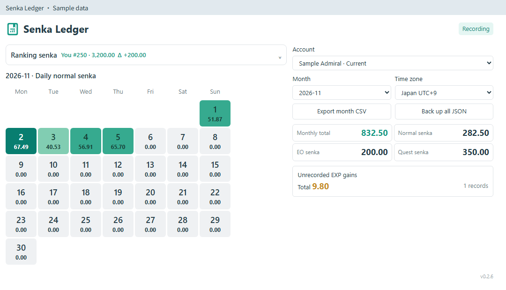
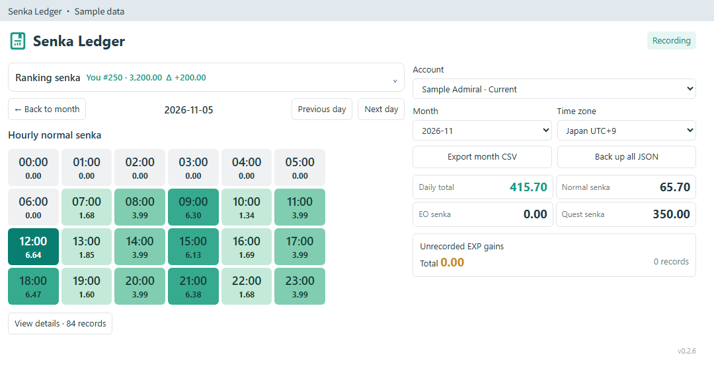
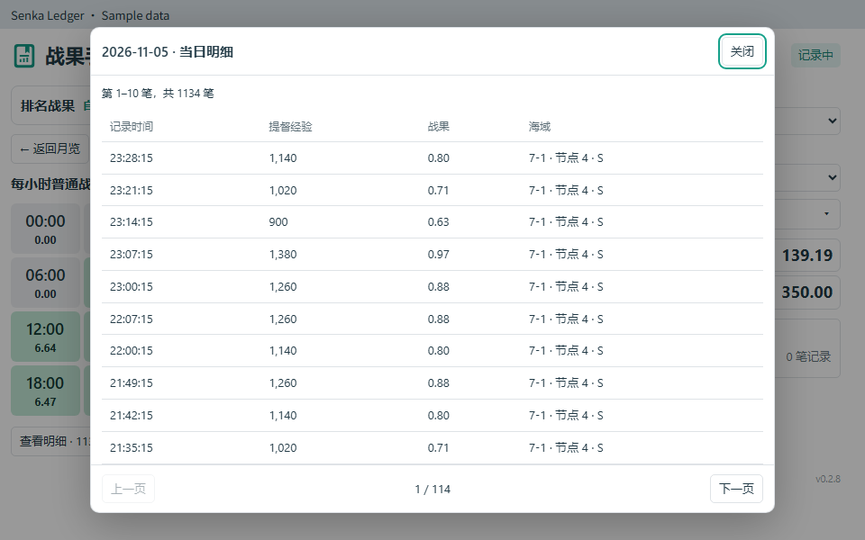

# 戦果手帳 · Senka Ledger

[English](README.md) · [简体中文](README.zh-CN.md) · [繁體中文](README.zh-TW.md) · [日本語](README.ja-JP.md) · [한국어](README.ko-KR.md)

**poi 12.0.1+** 用のローカル戦果記録プラグインです。

## 機能

- 過去の月、日別戦果、時間別の明細を閲覧。
- 出撃・演習・遠征の経験値戦果を記録し、EO・任務報酬を集計。EO または任務の合計をクリックすると報酬の明細を表示します。
- ローカル未記録の経験値戦果を、合計と発生し得る期間で表示。
- 自分と **1・5・20・100・500 位** の戦果、差分、前回更新からの増減を確認。
- アカウント別の履歴、タイムゾーンの保存、データのバックアップと復元。

日本語、英語、簡体字中国語、繁体字中国語、韓国語に対応。poi のメインパネルと別ウィンドウで利用できます。

## 使い方

poi のプラグイン管理から `poi-plugin-senka-ledger` をインストールするか、[GitHub Releases](https://github.com/asparagusThief/poi-plugin-senka-ledger/releases) のパッケージを使用します。有効にして母港に入ると記録が始まります。

アカウントと月を選び、日付をクリックすると時間別戦果、時間をクリックすると明細を表示します。明細はボタンまたはマウスホイールでページを切り替えられます。提督名は母港から取得し、未取得の場合は ID を表示します。

ランキングの記録には、ゲーム内のランキング一覧で該当ページを開いてください。増減は日本時間 **03:00／15:00** の直前の更新と比較します。前回分がない場合は `—` を表示します。

## 読み込みと出力

右側の**データ**ボタンを開きます。

| 操作 | 用途 |
| --- | --- |
| 月別 CSV を出力 | 選択したアカウント・月の記録を表計算ソフトで閲覧・分析。 |
| JSON 出力（全履歴） | 選択したアカウントの全履歴をバックアップ。復元や別の PC への移行に使用。 |
| JSON を読み込む | 戦果手帳が出力した JSON バックアップを選択。旧バージョンのバックアップにも対応。 |

記録はバックアップ内のアカウントに統合され、重複はスキップされます。既存の履歴を保持し、別アカウントの記録は分けて保存します。書き込み前に既存の記録を自動バックアップします。無効なファイルではローカル記録を変更しません。バックアップと統合後の記録は、それぞれ **32 MB・100,000 件** 以内です。

## 記録について

履歴は記録開始後から蓄積されます。通常戦果は `提督経験値 × 7 / 10000` で計算し、EO と対応任務の報酬は集計欄に表示します。対応任務 ID：`854, 888, 893, 872, 284, 845, 903`。

ローカル未記録の経験値増加は、ログイン時刻に割り当てず、発生し得る期間として保持します。日や月をまたぐ期間は複数の画面に表示されるため、その合計を足し合わせないでください。活動の集計には公式ランキングの引継ぎ戦果や月末補正を含みません。

データは `APPDATA_PATH/senka-ledger/` に保存します。トークン、パスワード、ゲームの完全な API 応答は保存しません。

## プレビュー

サンプルデータです。

MIT ライセンス。
