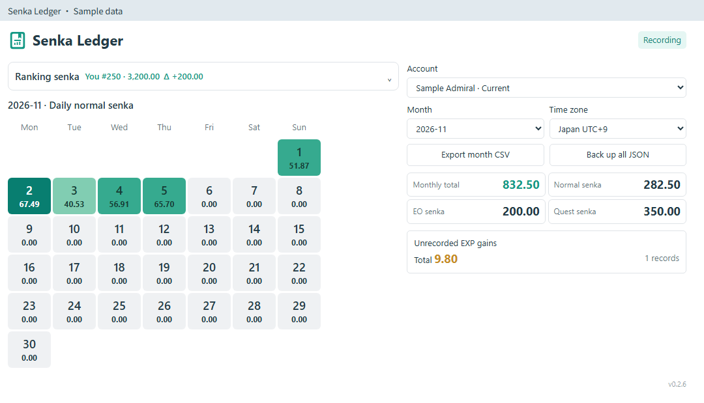
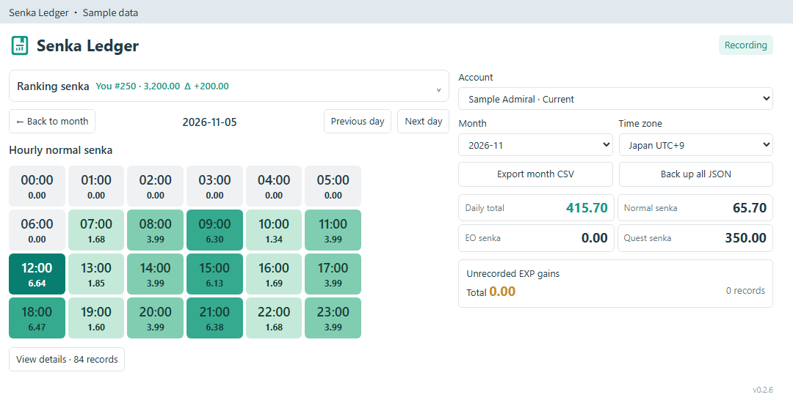
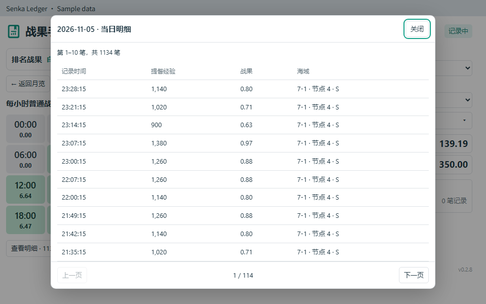

# 전과 수첩 · Senka Ledger

[English](README.md) · [简体中文](README.zh-CN.md) · [繁體中文](README.zh-TW.md) · [日本語](README.ja-JP.md) · [한국어](README.ko-KR.md)

**poi 12.0.1+**용 로컬 전과 기록 플러그인입니다.

## 기능

- 지난달 기록, 일별 전과와 시간별 상세 기록 조회.
- 출격·연습·원정의 경험치 전과 기록 및 EO·임무 보상 집계. EO 또는 임무 합계를 누르면 보상 상세를 볼 수 있습니다.
- 로컬 미기록 경험치 전과의 합계와 발생 가능 구간 표시.
- 자신과 **1·5·20·100·500위** 전과, 격차 및 이전 갱신 대비 변화 확인.
- 계정별 기록 보관, 시간대 저장, 데이터 백업과 복원.

한국어, 영어, 간체 중국어, 번체 중국어, 일본어를 지원하며 poi 기본 패널과 별도 창에서 사용할 수 있습니다.

## 사용 방법

poi 플러그인 관리에서 `poi-plugin-senka-ledger`를 설치하거나 [GitHub Releases](https://github.com/asparagusThief/poi-plugin-senka-ledger/releases)의 패키지를 사용하세요. 활성화한 뒤 모항에 들어가면 기록을 시작합니다.

계정과 월을 선택하고 날짜를 누르면 시간별 전과, 시간을 누르면 상세 기록을 볼 수 있습니다. 버튼이나 마우스 휠로 상세 기록의 페이지를 넘길 수 있습니다. 제독 이름은 모항에서 읽으며, 아직 이름을 확인하지 못한 계정은 ID로 표시합니다.

순위 전과를 기록하려면 게임 안에서 순위 목록의 해당 페이지를 열어 주세요. 변화량은 일본 시간 **03:00 / 15:00**의 직전 갱신과 비교합니다. 이전 기록이 없으면 `—`로 표시합니다.

## 불러오기 및 내보내기

오른쪽의 **데이터** 버튼을 여세요.

| 작업 | 용도 |
| --- | --- |
| 월별 CSV 내보내기 | 선택한 계정과 월의 기록을 스프레드시트에서 조회·분석합니다. |
| JSON 내보내기 (전체 기록) | 선택한 계정의 전체 기록을 백업하여 복구하거나 다른 PC로 옮깁니다. |
| JSON 불러오기 | 전과 수첩에서 내보낸 JSON 백업을 선택합니다. 이전 버전의 백업도 지원합니다. |

백업에 지정된 계정의 기록과 병합하고 중복 기록은 건너뜁니다. 기존 기록은 유지하며 다른 계정의 기록은 별도로 보관합니다. 변경 전에 해당 계정의 기존 기록을 자동으로 백업합니다. 잘못된 파일은 로컬 기록을 변경하지 않습니다. 백업과 병합 후 기록은 각각 **32 MB / 100,000개 기록** 이내여야 합니다.

## 기록 안내

기록은 플러그인을 사용하면서 쌓입니다. 일반 전과는 `제독 경험치 × 7 / 10000`으로 계산하고 EO와 지원 임무의 보상은 요약에 표시합니다. 지원 임무 ID: `854, 888, 893, 872, 284, 845, 903`.

로컬 미기록 경험치 증가는 접속 시각에 배정하지 않고 발생 가능한 시간 구간으로 보관합니다. 날짜나 월을 걸치는 구간은 여러 화면에 나타날 수 있으므로 합계를 더하지 마세요. 활동 집계에는 공식 순위의 이월 전과와 월말 보정이 포함되지 않습니다.

데이터는 `APPDATA_PATH/senka-ledger/`에 저장합니다. 토큰, 비밀번호, 게임 API 응답 전체는 저장하지 않습니다.

## 미리보기

예시 데이터입니다.

MIT 라이선스.
