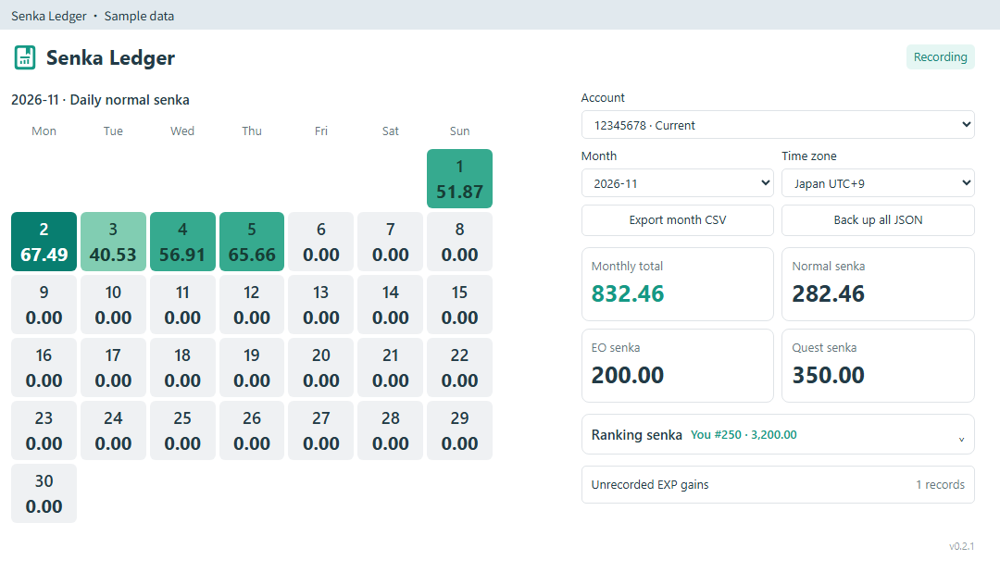
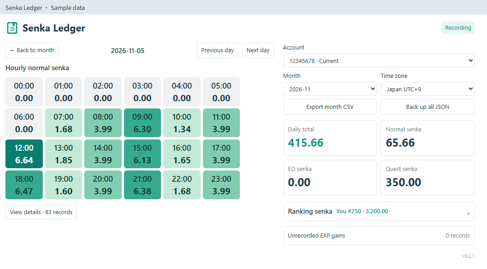
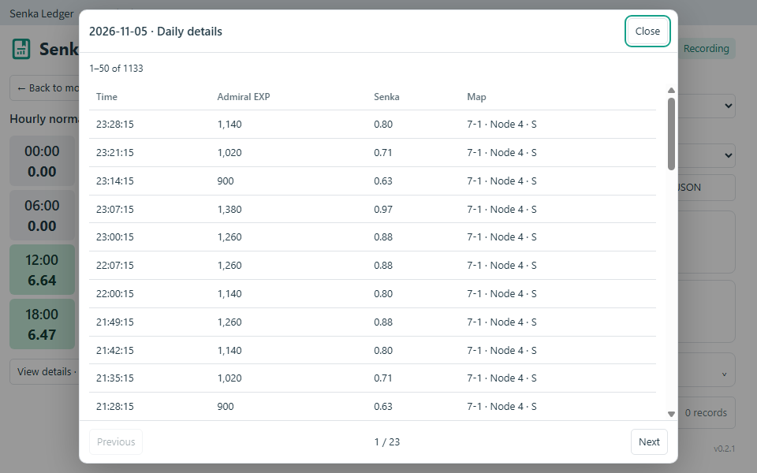

# Senka Ledger

[English](README.md) · [简体中文](README.zh-CN.md) · [繁體中文](README.zh-TW.md) · [日本語](README.ja-JP.md) · [한국어](README.ko-KR.md)

A local senka ledger for **poi 12.0.1** with daily history, hourly details and ranking snapshots. The original notebook icon is provided as SVG and registered in poi's icon library.

## Features

- A compact monthly calendar opens into daily and hourly views. Tiles stay on the left and filters, summaries and rankings stay on the right on wide panels; narrow panels stack them vertically. Date, time and score are centered.
- Normal senka comes from each sortie or practice result's explicit Admiral EXP reward, using `EXP × 7 / 10000`. EO and quest rewards appear only in the summaries.
- Details open in a separate modal dialog with its own scrolling and **50 records per page**, instead of filling the daily view with a long table. Click an hour for that hour's details, or use **View details** for the full day. Unrecorded gains also open in a dialog.
- Unobserved EXP gains retain their possible interval and are excluded from login-day and login-hour activity. Unobserved EO and quest rewards are not inferred.
- Ranking snapshots show your own score and positions **1, 5, 20, 100 and 500**, when those pages have been observed. Ranking scores are separate from activity totals.
- Independent scrolling works in poi's main panel and its **Open in window** portal. Narrow layouts wrap controls and summaries; wide tables and calendars can scroll horizontally without overlapping text.
- Follows poi's language: English, Simplified Chinese, Traditional Chinese, Japanese or Korean. CSV headers, battle details and storage errors are localized as well.
- Account-separated append-only journals, previous months, CSV export and complete JSON backup.

## Preview

The screenshots use synthetic data.







## Install and use

Install **`poi-plugin-senka-ledger`** in poi's plugin manager, or install the `.tgz` from [GitHub Releases](https://github.com/asparagusThief/poi-plugin-senka-ledger/releases).

Enable the plugin and visit the home port to establish a live EXP baseline. Select a month, click a date, then click an hour to open the normal-senka detail dialog. EO and quest rewards remain in the summaries.

Practice rewards are identified as local activity when their explicit reward is present. Any extra cumulative EXP outside that reward remains unlocated. This fix applies to newly observed results; older unlocated records without a stored source cannot be safely reclassified.

For ranking data, **open the ranking list inside the game** and visit the relevant pages, including your own entry. Expand the ranking section in the plugin to inspect scores and read times. The plugin observes normal game responses; it does not send ranking requests or operate the game. Same-name entries are not treated as yours when identity is ambiguous. Old snapshots keep their read time. At the start of a month, ranking responses read before 03:00 JST remain associated with the previous month.

The plugin ID now matches the package name, correcting poi's active-plugin heading. Window, pin and favorite preferences from the previous ID are migrated. The journal location is unchanged.

## Data and limits

Journals live at `APPDATA_PATH/senka-ledger/<accountID>.jsonl`, normally `%APPDATA%\poi\senka-ledger\` on Windows. Every accepted record is appended and flushed to disk. Tokens, passwords, complete responses and other players' names are not stored. One writer owns each data directory; damaged or incomplete records pause writing while preserving the original file.

History starts when recording starts. Earlier individual battles cannot be recovered from the game. Cross-month EXP gaps are shown as intervals, without assigning them to a particular month. Activity totals use natural calendar days/months in the selected time zone; they do not calculate ranking carryover, monthly deadlines or deferred quest rewards.

Seven regular quarterly senka quests are supported: `854, 888, 893, 872, 284, 845, 903`. Other quests are not inferred. The ranking decoder follows the current observed obfuscated response format; invalid or insufficient data is not displayed as a new score. A game update may require decoder changes.

Back up the data folder before replacing a damaged journal. To restore, close all poi instances and restore the original `<accountID>.jsonl` file. A JSON backup's `journal` field contains that exact text. There is no in-app import yet. Version 0.1.x journals remain readable.

## Development

Node.js 20+; no build step or extra runtime dependencies. React and the icon library come from poi.

```powershell
npm run check
npm test
npm run pack:local
# Optional source installation; refuses to overwrite an existing plugin.
& .\scripts\install-local.ps1
```

The package is generated in `dist/`. `scripts/preview.js <React-18-UMD-directory> <output.html>` creates a synthetic browser preview; it never opens a real journal. It supports all five languages, a real React portal window and layout stress cases.

References: [poi](https://github.com/poooi/poi), [Ranking Calc](https://www.npmjs.com/package/poi-plugin-senka-calc). This is an independent implementation and icon design. MIT license.
