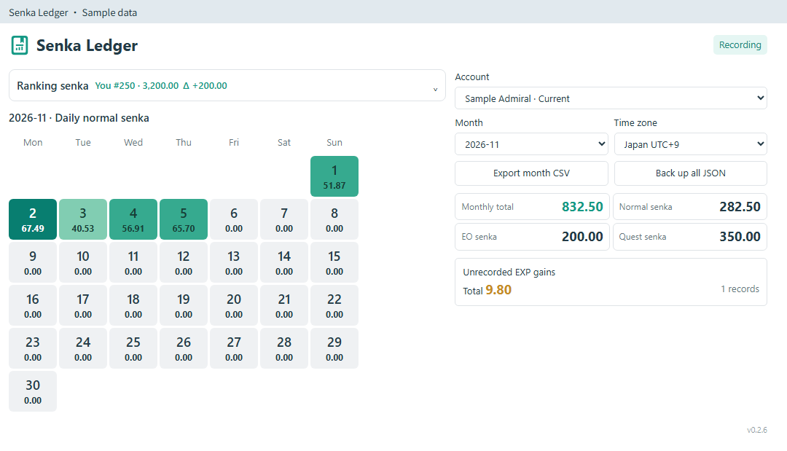
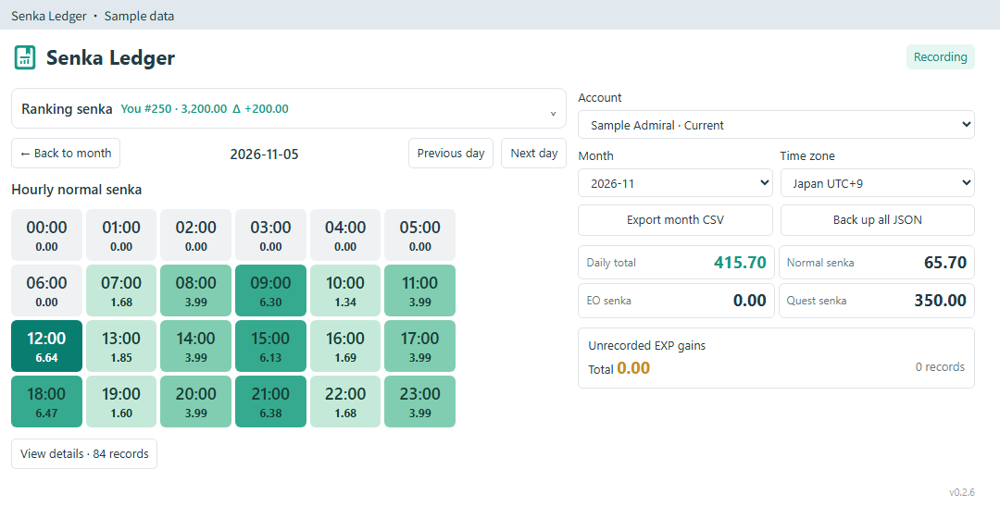
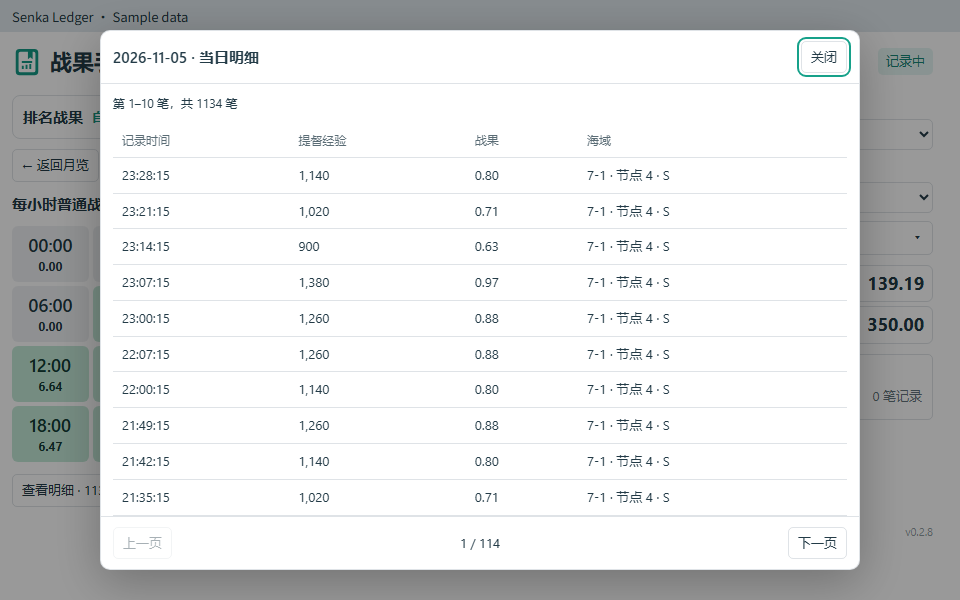

# 战果手账 · Senka Ledger

[English](README.md) · [简体中文](README.zh-CN.md) · [繁體中文](README.zh-TW.md) · [日本語](README.ja-JP.md) · [한국어](README.ko-KR.md)

适用于 **poi 12.0.1+** 的本地战果记录插件。

## 功能

- 查看往月记录、每日与每小时战果，点击日期或小时查看明细。
- 记录本地出击、演习、远征获得的普通战果，按 `提督经验 × 7 / 10000` 换算。EO 和支持的任务战果在汇总区显示。
- 未记录的经验战果单独显示合计及可能发生区间，不计入登录当天或登录小时。
- 查看自己和第 **1、5、20、100、500** 名的排名战果、与你的差额及较上期的变化。
- 明细支持按钮和鼠标滚轮翻页，每页随窗口高度调整，最多 10 条。
- 记住时区，账号列表显示提督名，支持 CSV 导出、JSON 备份，各账号独立保存。
- 支持简体中文、繁体中文、英语、日语、韩语，适配主面板与独立窗口。

## 使用

1. 在 poi 插件管理中安装 `poi-plugin-senka-ledger`，或从 [GitHub Releases](https://github.com/asparagusThief/poi-plugin-senka-ledger/releases) 下载 `.tgz`。
2. 启用后进入母港，建立提督经验基准。
3. 选择账号、月份和时区，时区会保留到下次打开。提督名从母港数据读取，未读取到名字的账号暂用编号显示。点击日期查看小时战果，再点击小时打开明细。

排名数据需在游戏中打开排名列表并查看相应页面。差值比较日本时间每日 **03:00／15:00** 更新的紧邻上一期；缺少上期记录时显示 `—`。插件不主动发送游戏请求。

## 数据

历史从开始记录后积累，本地奖励按结算响应的接收时间记账。未记录增量保留完整的可能发生区间，跨日、跨月的区间合计不能相加。活动汇总不计算官方排名继承与月末调整。

支持的战果任务：`854, 888, 893, 872, 284, 845, 903`。

遇到启动卡住或配置文件异常增大，参见[配置恢复说明](https://github.com/asparagusThief/poi-plugin-senka-ledger/blob/main/docs/recovery.md)。

日志位于 `APPDATA_PATH/senka-ledger/<账号ID>.jsonl`。JSON 用于换电脑、重装 poi 或数据损坏后恢复全部历史。还原时关闭所有 poi，备份原文件，再把 JSON 中 `journal` 字段的完整文本保存为该目录下的 `<账号ID>.jsonl`。目前没有界面导入功能；日常查看和整理数据可使用 CSV。不保存 token、密码或完整 API 响应。

## 预览

下图使用模拟数据。







## 开发

需要 Node.js 20+，运行依赖由 poi 提供。

```text
npm run check
npm test
npm run pack:local
```

安装包生成于 `dist/`。`scripts/install-local.ps1` 可从源码安装，不覆盖已有插件。

MIT 许可证。
