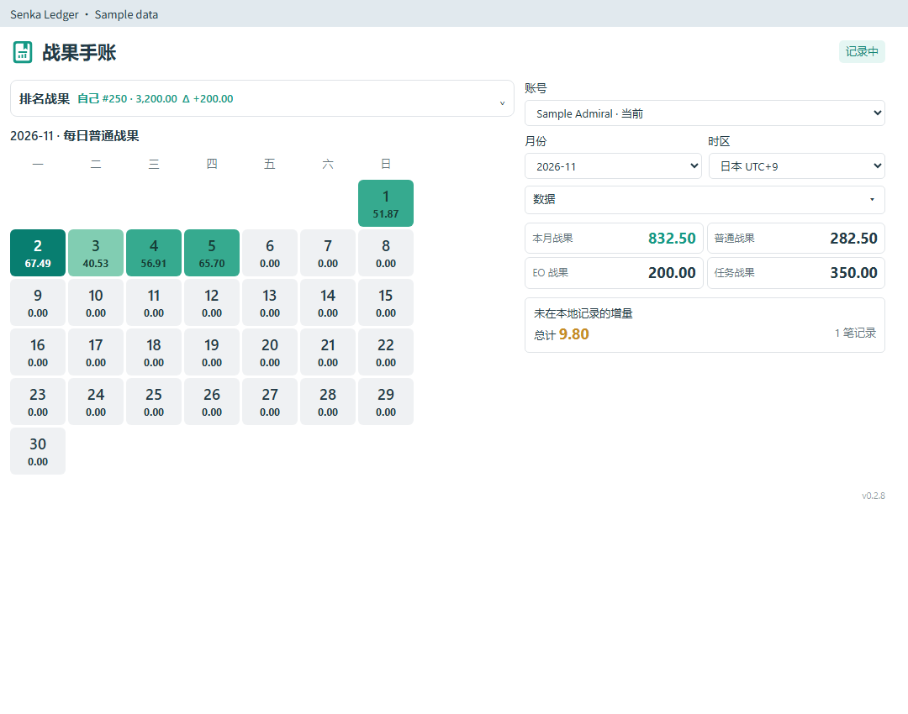
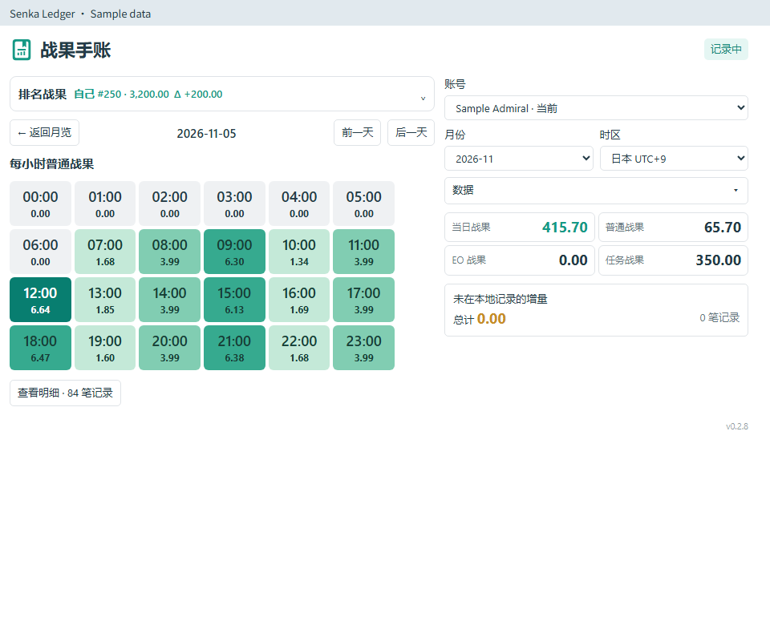
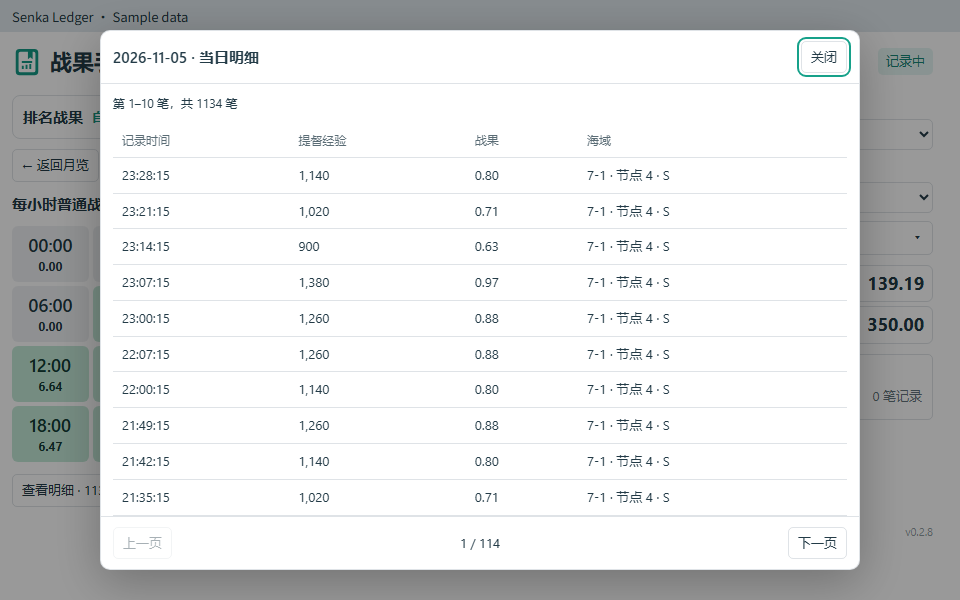

# 戰果手帳 · Senka Ledger

[English](README.md) · [简体中文](README.zh-CN.md) · [繁體中文](README.zh-TW.md) · [日本語](README.ja-JP.md) · [한국어](README.ko-KR.md)

適用於 **poi 12.0.1+** 的本機戰果記錄插件。

## 功能

- 查看往月記錄、每日戰果與每小時明細。
- 記錄出擊、演習、遠征的經驗戰果，彙總 EO 與任務獎勵。
- 分別查看未在本機記錄的經驗戰果合計與可能發生區間。
- 查看自己與第 **1、5、20、100、500** 名的排名戰果、差額及較上次更新的變化。
- 各帳號獨立儲存歷史，記住時區，支援資料備份與還原。

支援繁體中文、簡體中文、英語、日語及韓語，可於 poi 主面板或獨立視窗中使用。

## 開始使用

在 poi 插件管理安裝 `poi-plugin-senka-ledger`，或使用 [GitHub Releases](https://github.com/asparagusThief/poi-plugin-senka-ledger/releases) 的安裝包。啟用後進入母港，開始記錄。

選擇帳號與月份，點選日期查看每小時戰果，再點選小時開啟明細。明細可用按鈕或滑鼠滾輪翻頁。提督名從母港讀取，尚未讀取到名字的帳號顯示編號。

讀取排名戰果時，在遊戲內開啟排名列表並查看對應頁面。差值比較日本時間每日 **03:00／15:00** 更新的上一期；缺少上期記錄時顯示 `—`。

## 匯入與匯出

點選右側的**資料**按鈕：

| 操作 | 用途 |
| --- | --- |
| 匯出本月 CSV | 使用試算表軟體查看或分析所選帳號、月份的記錄。 |
| 匯出 JSON（全部歷史） | 備份所選帳號的全部歷史，用於還原資料或遷移電腦。 |
| 讀取 JSON | 選擇戰果手帳匯出的 JSON 備份，亦支援較早版本的備份。 |

讀取後依備份中的帳號合併記錄，自動略過重複資料並保留既有歷史，不同帳號分別儲存。寫入前自動備份該帳號的本機日誌；檔案無效時不變更本機記錄。備份及合併後的日誌各限 **32 MB、100,000 筆記錄**。

## 關於記錄

歷史從開始記錄後累積。一般戰果按 `提督經驗 × 7 / 10000` 換算，EO 與支援的任務獎勵顯示於彙總區。支援的任務編號：`854, 888, 893, 872, 284, 845, 903`。

未在本機記錄的經驗增量保留可能發生區間，不計入登入時間點。跨日、跨月的區間可能出現在多個檢視中，這些合計不可相加。活動彙總不包含官方排名繼承與月底調整。

資料儲存於 `APPDATA_PATH/senka-ledger/`，不儲存 token、密碼或完整遊戲回應。

## 預覽

下圖使用模擬資料。

MIT 授權。
